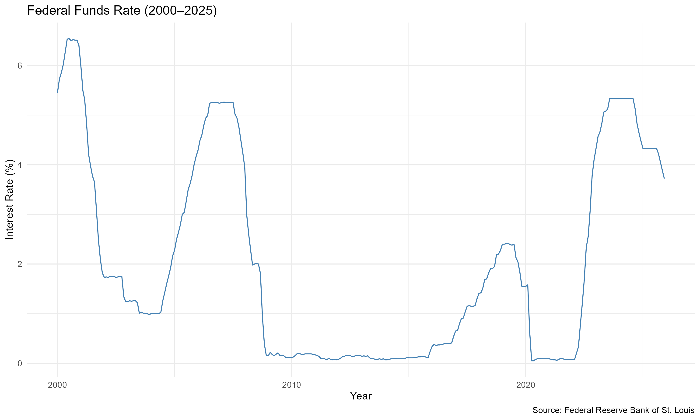
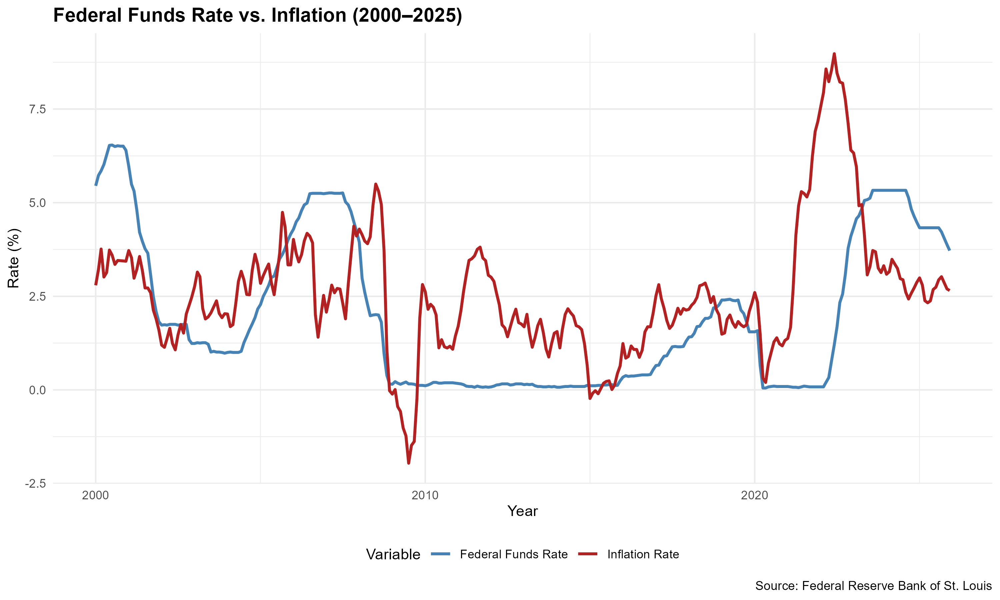
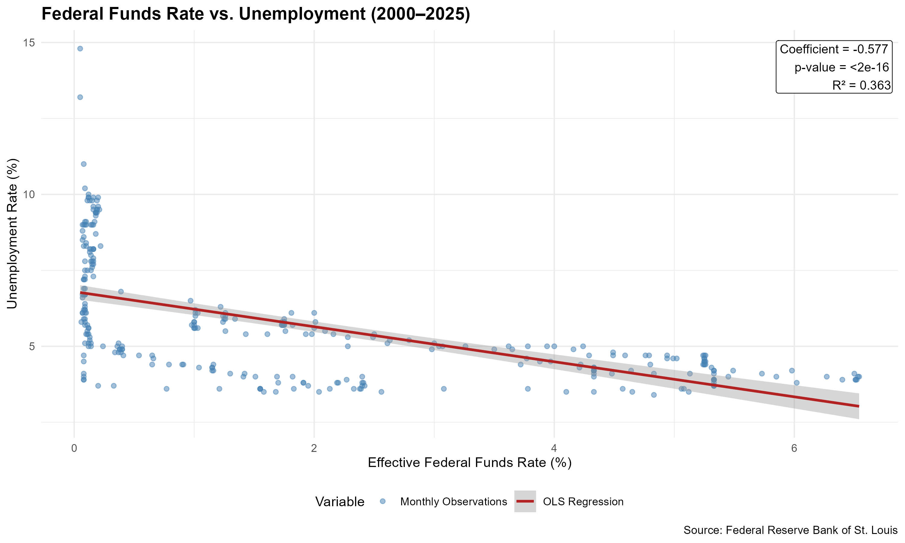

# Federal-Funds-Rate-Inflation-and-Unemployment-2000-2025

## Overview
This project provides a descriptive analysis of the federal funds rate, inflation, and unemployment from 2000 to 2025. 

## Data
The analysis used monthly observations from January 2000 to December 2025, which were gathered from the Federal Reserve Bank of St. Louis's FRED database. 

| Variable | FRED Series | Description |
|---|---|---|
| Federal Funds Rate | FEDFUNDS | Monthly effective federal funds rate (%) |
| Consumer Price Index | CPIAUCSL | Consumer Price Index for All Urban Consumers |
| Unemployment Rate | UNRATE | Monthly U.S. unemployment rate (%) |

Inflation is calculated as the year-over-year change in the CPI

## Methodology
The analysis was solely conducted in R using the quantmod, tidyverse, and ggplot2 packages

**Data collection and transformation:** Economic indicators were retrieved from FRED using the quantmod package. 
The observations were then combined into a monthly dataset, then the data was transformed to calculate                    
year-over-year inflation.

**Data visualization:** Three graphs were created to illustrate historical trends in interest rates, inflation, and unemployment.

**Regression Analysis:** Two OLS models were estimated to examine the relationship between the federal funds rate and unemployment, with the second model controlling for inflation. 

## Results and Visualizations

### Figure 1: Federal Funds Rate (2000–2025)

The federal funds rate fluctuated substantially during the 25 year period. There were clear reductions after the 2008 financial crisis and the COVID-19 pandemic. There was a clear spike in 2022 due to monetary tightening. 
### Figure 2: Federal Funds Rate vs. Inflation

The comparison illustrates how changes in inflation and interest rates have coincided over time. Particularly notable is the inflationary surge beginning in 2021, followed by substantial increases in the federal funds rate during 2022 and 2023.
### Figure 3: Federal Funds Rate vs. Unemployment

The scatterplot displays monthly observations of the federal funds rate and unemployment, alongside an OLS regression line and its 95% confidence interval.

The fitted line summarizes the observed linear association between the federal funds rate and unemployment over the study period.
